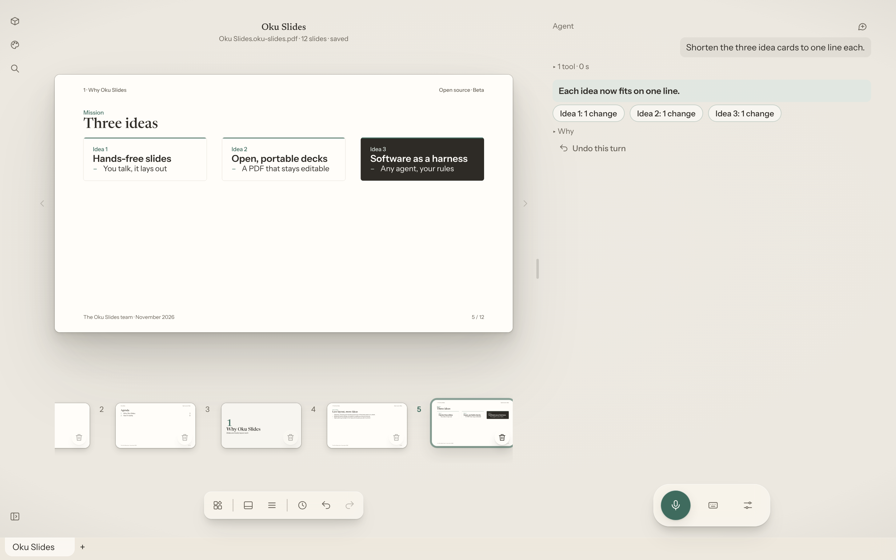

# Oku Slides

**Say it, see it on a slide.** Oku Slides is a desktop presentation editor you drive by
voice. You describe what you want, an AI agent of your choice builds and edits the slides,
and the result is a plain PDF that anyone can open and that Oku Slides can open again to
keep editing.

> **Beta.** Oku Slides is under active development: expect rough edges, and keep copies
> of decks that matter. Feedback and bug reports are welcome in
> [Issues](https://github.com/oku-theory/oku-slides/issues).



## Why Oku Slides

### Hands-free slides

Making slides is mostly layout work: aligning, resizing, restyling, keeping twenty slides
consistent. Oku Slides lets you skip it. Dictate an idea ("add a slide comparing our three
plans, as a table") and the agent does the layout. Every action in the app can be asked
of the agent, settings included, so you can build a whole deck without touching the
keyboard or the mouse, and still edit by hand whenever you prefer.

### Open, portable decks

An Oku Slides deck is a `.oku-slides.pdf` file. Any PDF viewer shows it as is, so you can
send it, print it or present it anywhere. Inside, the PDF carries its own sources (slides,
fonts, images, layouts, theme and full history), so Oku Slides reopens it as an editable
deck. No account, no cloud, no proprietary format: your decks live in your folders.
Two copies edited separately merge without conflicts.

For an example, open [the Oku Slides presentation](docs/oku-slides-presentation.oku-slides.pdf):
it reads as a regular PDF, and Oku Slides opens it as an editable deck.

### Software as a harness

Oku Slides does not ship its own AI. It is a **harness for agents**: it gives an agent the
tools to read and edit a deck, and the guardrails that keep you in control.

- **Bring your own agent.** Claude, Codex and Gemini come preconfigured; any agent speaking
  the [Agent Client Protocol](https://agentclientprotocol.com) works. A built-in local
  agent runs on your computer with no account or network.
- **Narrow, safe tools.** The agent gets no file system or terminal access from Oku Slides:
  it works only through the app's own tools, served locally with a token per tab.
- **Everything undoes.** A whole agent turn is a single ⌘Z.
- **You decide what can't be undone.** Saving, deleting or changing app settings waits for
  your confirmation, by click or by voice.
- **Decisions stay yours.** The agent asks questions in place, proposes variants side by
  side, and exposes live settings you can tweak.

The app is the stable, well-tested part; the agent is interchangeable. As agents improve,
Oku Slides improves with them, without giving up control of your documents.

## Features

- **Voice dictation, on device.** Apple's speech engine on macOS 26+, or Whisper running
  locally; voice detection, sentence-by-sentence transcription, multilingual. Optionally
  OpenAI or Azure OpenAI for company setups.
- **Agent editing.** One conversation per tab, several tabs working at once, questions and
  variants rendered right on the slide, an optional detached agent window for a second screen.
- **Hand editing.** Select, move, resize and edit text directly on the slide; a snapping
  grid keeps everything aligned; full keyboard shortcuts.
- **Charts and tables.** Charts rendered as vector graphics, tables with headers, stripes
  and alignment, and a data grid to edit both. A chart converts to a table and back.
- **Layouts, themes and widgets.** Layout packs, themes built from design tokens (Papier,
  Pro and Neutre built in), and custom widgets written in [Typst](https://typst.app),
  edited with a live preview.
- **PowerPoint import.** Open a `.pptx` either as a faithful copy or remapped onto your own
  layouts and theme; the agent can then fine-tune the slides that differ most from the
  original.
- **History and merge.** Every version is stored in the file: walk back through it, restore
  one, or merge two copies of the same deck.
- **Tabs, windows, autosave.** One deck per tab, several windows, everything restored at
  next launch; every change is saved automatically.
- **20 interface languages.** The agent answers in yours.
- **Command-line tool.** Render, import, extract or strip decks from scripts.

## Getting started

1. Download the latest version for macOS (Apple Silicon or Intel), Windows or Linux from
   [Releases](https://github.com/oku-theory/oku-slides/releases). The app updates itself.
2. Pick an agent. Claude is the default; Codex, Gemini or the built-in local agent can be
   chosen instead (ask the agent, or see [configuration](docs/configuration.md)). Cloud
   agents need their own account; the local one needs nothing.
3. Press **⌘D** (or the mic) and speak. Your words land in a draft in the right panel:
   review it, then send it to the agent with **⌘↩**. You can also type an instruction
   with **⌘K**.
4. Your deck is saved automatically in `Documents/Oku Slides`. Share the `.oku-slides.pdf`
   as is.

Press **⌘?** in the app for the built-in help.

## Documentation

| Guide | Contents |
| --- | --- |
| [Using Oku Slides](docs/usage.md) | Workspace, shortcuts, charts, packs and themes, dictation, the agent |
| [Configuration](docs/configuration.md) | `config.toml`, every setting, environment variables |
| [Development](docs/development.md) | Repository layout, command-line tool, building and testing |
| [Presentation deck](docs/oku-slides-presentation.oku-slides.pdf) | Oku Slides in 12 slides, made with Oku Slides |
| [Architecture decisions](docs/adr/README.md) | Why things are built the way they are |
| [Security](SECURITY.md) | Reporting a vulnerability |

## Building from source

Oku Slides is written in Rust ([Tauri 2](https://tauri.app), [Typst](https://typst.app),
[Loro](https://loro.dev)) with a React + TypeScript interface. With Rust, [Bun](https://bun.sh),
[just](https://just.systems), cmake, the Tauri CLI, Git LFS and, on a Mac, Xcode with the
macOS 26 SDK:

```sh
git lfs install && git clone git@github.com:oku-theory/oku-slides.git && cd oku-slides
just doctor   # check prerequisites
just dev      # run the desktop app in development
```

See [Development](docs/development.md) for everything else.

## License

Licensed under either of [Apache License 2.0](LICENSE-APACHE) or [MIT license](LICENSE-MIT),
at your option.
